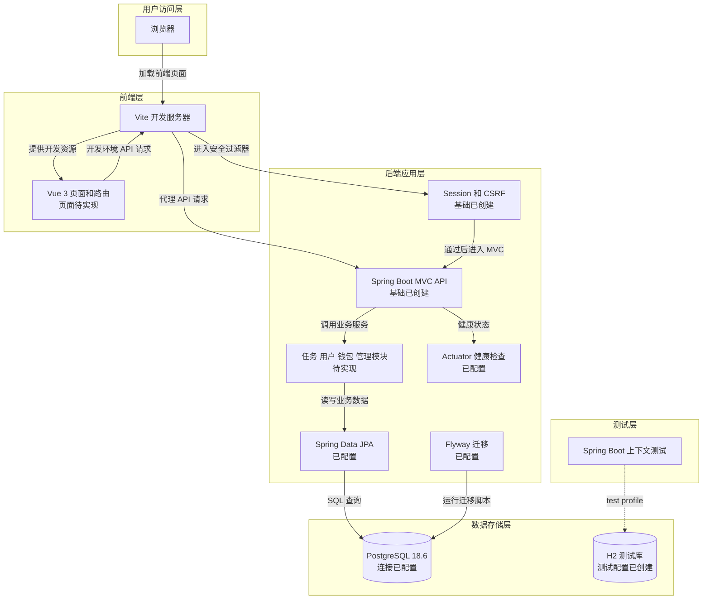
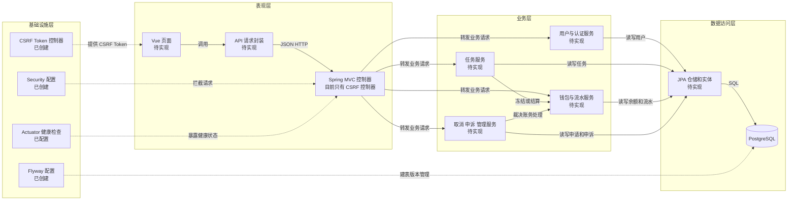

# Architecture Diagram

本项目采用前后端分离的单体应用：Vue 浏览器端通过 HTTP API 访问一个 Spring Boot 后端，后端使用 PostgreSQL 持久化业务数据。当前仓库刚搭好开发骨架，图中明确区分了“已有基础”与“计划实现”的业务组件。

## Application Architecture

<!-- mermaid-checked: no \n, no em-dash/en-dash, no {} in labels, subgraphs are id["label"], arrows are -->|"label"|, all subgraphs closed by end, ids unique -->

### Technology Stack Summary

| Layer | Technology | Version | Purpose |
|---|---|---:|---|
| Browser UI | Vue | 3.5.44 | 构建用户和管理员界面 |
| Frontend development | Vite | 8.3.4 | 本地开发服务器、构建静态资源、代理 API |
| Frontend routing | Vue Router | 4.6.4 | 前端页面路由；依赖已安装，路由尚未实现 |
| Backend runtime | Java | 21.0.12.1 | 运行后端应用 |
| Backend framework | Spring Boot | 4.1.1 | 提供 MVC、依赖注入和应用启动 |
| Backend build | Maven Wrapper | 3.9.16 | 统一构建与测试 |
| Persistence | Spring Data JPA | Spring Boot 管理 | 后端 ORM 与仓储基础，业务实体尚未创建 |
| Database | PostgreSQL | 18.6 | 计划用于本地开发和业务持久化 |
| Database migration | Flyway | Spring Boot 管理 | 管理数据库结构迁移；尚无业务迁移脚本 |
| Test database | H2 | Spring Boot 管理 | 后端上下文测试使用的内存数据库 |
| Security | Spring Security | 4.1.1 dependency line | Session、CSRF 与请求访问控制基础 |
| Health monitoring | Spring Boot Actuator | 4.1.1 | 暴露健康检查和基础信息 |

### Data Storage & External Services

后端已配置 PostgreSQL 连接、JPA 和 Flyway，但目前还没有业务表或迁移文件；表结构应通过后续 Flyway 脚本建立。自动化上下文测试使用 H2 内存数据库。当前没有 Redis、消息队列、邮件服务或外部支付平台；开发期间 Vite 代理 API 到本地后端，生产部署的反向代理和 HTTPS 终止位置尚未确定。

### Key Architectural Decisions

- 首版采用**模块化单体**：用户、任务、钱包、取消/申诉和管理功能先放在一个 Spring Boot 应用中，不拆成微服务。
- 浏览器通过 JSON HTTP API 与后端通信；Vite 代理仅用于本地开发，生产请求路由需在部署阶段确定。
- 账务余额和流水由后端业务事务统一维护；前端不能直接改任务状态或账户余额。

## Component Relationships

<!-- mermaid-checked: no \n, no em-dash/en-dash, no {} in labels, subgraphs are id["label"], arrows are -->|"label"|, all subgraphs closed by end, ids unique -->

### Component Inventory

| Component | Layer | Type | Responsibility |
|---|---|---|---|
| Vue 页面与 Vue Router | 表现层 | 前端视图与路由 | 任务大厅、发布、我的任务、钱包和管理页面；目前仅有开发状态页，业务页面待实现 |
| API 请求封装 | 表现层 | 前端基础模块 | 统一 API 前缀、Session Cookie、CSRF Token 和错误提示；待实现 |
| Spring MVC 控制器 | 表现层 | 后端 HTTP 接口 | 接收和响应 API 请求；应用骨架已建，目前只有 CSRF Token 控制器 |
| 用户与认证服务 | 业务层 | 服务 | 注册、登录、用户查询和权限关联；待实现 |
| 任务服务 | 业务层 | 服务 | 发布、接单、送达、验收、修改和撤回；待实现 |
| 钱包与流水服务 | 业务层 | 服务 | 余额查询、冻结、解冻、结算和流水；待实现 |
| 取消、申诉与管理服务 | 业务层 | 服务 | 取消申请、未完成任务裁决、已完成任务申诉及管理处理；待实现 |
| JPA 仓储与实体 | 数据访问层 | Repository 与 Entity | 将业务对象持久化到 PostgreSQL；依赖已引入，业务实体和仓储待实现 |
| Security 配置 | 基础设施层 | 安全配置 | 配置 Session、CSRF 和默认鉴权规则；基础已创建 |
| CSRF Token 控制器 | 基础设施层 | REST 控制器 | 提供前端获取 CSRF Token 的入口；已创建 |
| Flyway | 基础设施层 | 数据库迁移 | 按版本建立和升级数据库结构；依赖与配置已加入，迁移脚本待实现 |
| Actuator | 基础设施层 | 运维端点 | 暴露健康检查；已配置 |
