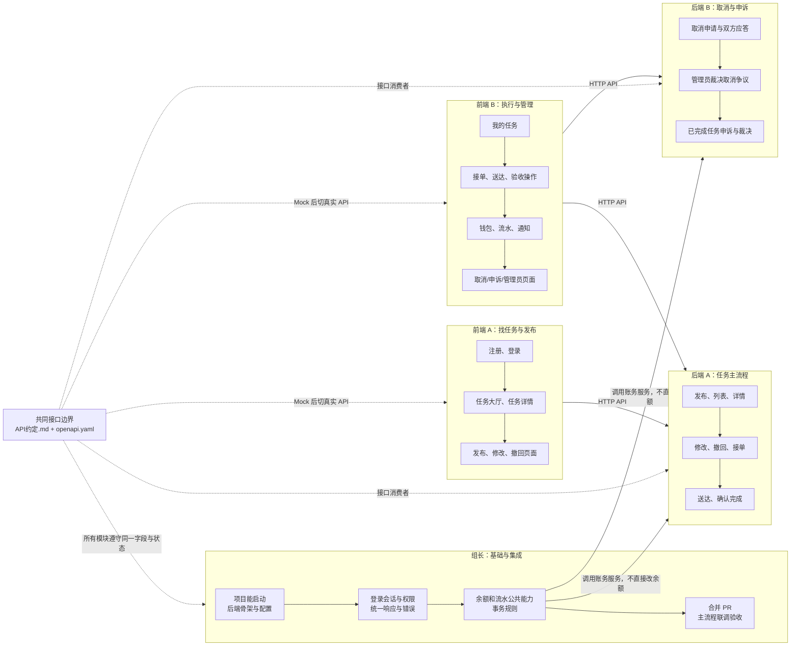
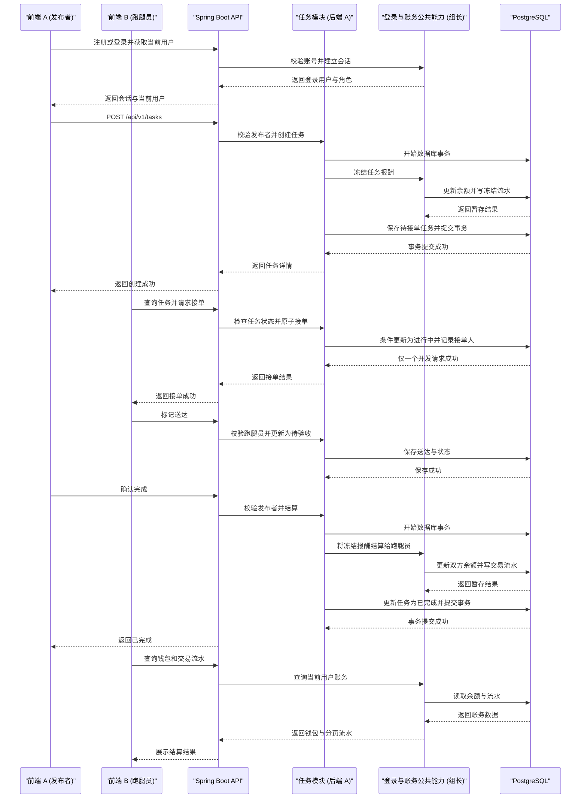
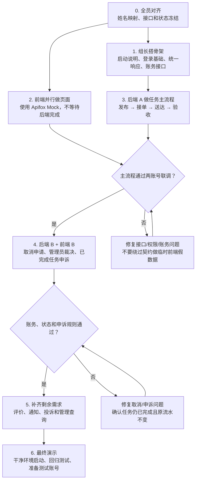

# 分工边界与任务图

> 本图解用于组会分工。姓名与“组长、前端 A/B、后端 A/B”的对应关系由小组自行填入；接口以同目录的 [API约定.md](./API约定.md) 和 [openapi.yaml](./openapi.yaml) 为准。

## 图 1：五个人各自负责什么

### 边界规则

- **后端按业务模块分**：后端 A 管任务状态与执行；后端 B 管取消、申诉和管理员裁决；组长提供登录、统一响应和账务公共能力。
- **前端按用户流程分**：前端 A 管注册登录和发布找任务；前端 B 管接单执行、钱包通知与管理操作。
- **前后端不是各自闭门开发**：一个功能由前端页面负责人和后端接口负责人配对验收。
- **数据库不单独甩给一人**：组长先定公共约束；后端 A/B 分别提交自己业务表的迁移脚本；组长负责合并。不要多人同时改同一张核心表。
- **状态只由业务接口改变**：前端不直接写状态；不提供“任意设置任务状态”的接口。
- **账务只通过公共服务改动**：业务模块不得绕过账务服务直接更新余额；余额与流水必须同事务。

## 图 2：第一条可演示流程，谁接哪一段

> 任务创建与报酬冻结、任务完成与报酬结算分别必须在单一数据库事务中完成；任一步失败，相关状态、余额和流水整体回滚。

**配对关系**：前端 A ↔ 后端 A 完成发布；前端 B ↔ 后端 A 完成接单/送达；前端 A ↔ 后端 A 完成验收；组长提供的账务能力被任务模块调用；最后由组长组织两账号端到端验收。

## 图 3：开发先后顺序与阶段出口

## 这周每个人先做的第一件事

| 角色 | 第一件可提交的任务 | 验收 |
|---|---|---|
| 组长 | 确认本地开发说明、登录与统一错误响应；提供账务服务调用约定 | 其他成员能启动工程、能读懂统一错误格式 |
| 前端 A | 建登录页和任务列表页，用 Mock 展示任务状态 | 页面可运行；字段与 OpenAPI 一致 |
| 前端 B | 建我的任务页与接单/送达/验收操作入口，用 Mock 演示状态变化 | 页面只发业务动作，不直接改状态 |
| 后端 A | 从任务列表/详情接口或发布任务接口开始，添加最小测试 | 接口能启动、有成功和失败验收 |
| 后端 B | 先建立取消/申诉模型和状态迁移测试，再实现接口 | 申诉状态与任务状态分离，重复申诉会被拒绝 |

## 每个小任务的完成定义

1. 有一个明确负责人和对应的 API 路径或页面。
2. 前端/后端遵守同一份 OpenAPI 契约；改动字段前先通知对接人。
3. 能说明成功路径、至少一个失败路径，并运行构建或测试。
4. 通过 PR 合并；PR 说明写清文件、测试命令和结果。
5. 合并后主分支仍能启动。优先每天集成小改动，不要攒成一次大合并。
